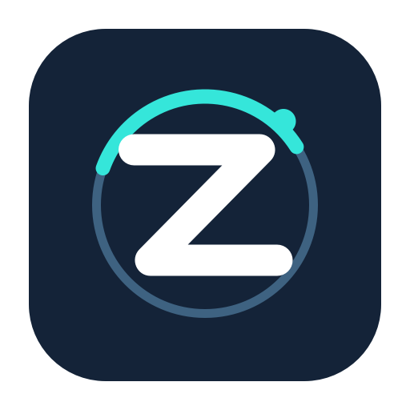

<p align="center">
  
</p>

<h1 align="center">ZeroClick</h1>

<p align="center"><strong>Drop a file. Choose an action. Keep moving.</strong></p>

<p align="center">A local, menu-bar file utility for Apple silicon Macs.</p>

<p align="center">
  <a href="https://github.com/MithunDB/ZeroClick/releases/latest/download/ZeroClick-macOS-arm64.zip">⬇️ Download ZeroClick.app</a>
  &nbsp;·&nbsp; <a href="#quick-start">Quick start</a>
  &nbsp;·&nbsp; <a href="#whats-inside">What's inside</a>
</p>

> **Local macOS release:** The downloadable build includes the tested local tools, protected ZIP unlocking, ZeroClick-created encrypted files, PNG message hiding, local image upscaling, and visible disabled actions. The AI wheel is a disabled preview.

**Upscale images** appears in the Shift+Option Tools wheel. It runs on the Mac with one bundled illustration-oriented 4× model; optional `.param`/`.bin` model pairs can be imported into Application Support and are not included in the app package. See [the upscaling audit](docs/UPSCALING_AUDIT.md) for the model and dependency notices.

ZeroClick works from a Finder drag. It reads and writes files locally, with no uploads or telemetry. Conversions and editing tools save new copies; only the explicit **Move** action relocates a selected file.

ZeroClick is a local derivative of Satsuma, an open-source reimplementation of the Tangerine workflow: 190 conversion options across images, video, audio, documents, subtitles and archives, and 33 advanced file tools.

Password-protected PDFs can be unlocked into a separate unprotected copy. The original stays encrypted.

## Quick start

1. [Download the latest ZeroClick.app ZIP](https://github.com/MithunDB/ZeroClick/releases/latest/download/ZeroClick-macOS-arm64.zip) from GitHub Releases. The automatic GitHub “Source code” archives contain source, not the app.
2. Unzip it, then move **ZeroClick.app** to Applications.
3. Open the app. It lives in the menu bar, so it will not add a Dock icon.
4. Start dragging a file in Finder and hold a modifier to show a wheel:

| Hold while dragging | Wheel | What it does |
| --- | --- | --- |
| **Shift** | Convert | Convert to compatible formats |
| **Shift + Option** | Tools | Open editors, compression, PDF tools, and more |
| **Command** or **Control** | File and privacy actions | Copy Path, Duplicate, Move, ZIP, redaction, protected-file access, and encryption |
| **Option** | AI · Coming later | Shows planned actions; nothing runs |

ZeroClick requires an **Apple silicon Mac with macOS 26 or later**. The downloadable app does **not** require Brisk, Xcode, or a Git clone. Some non-native media formats need optional `ffmpeg`; RAR decoding uses macOS `bsdtar`. This build is ad-hoc signed, not Developer ID notarized, so macOS may ask you to approve opening it in **System Settings → Privacy & Security** on first launch.

## What's inside

- **190 conversion routes** across images, audio, video, documents, subtitles, and archives.
- **33 local tools** for editing, redaction, compression, PDF pages, local text recognition, upscaling, and more.
- **Safe outputs** with collision-resistant names, staged writes, cancellation, and operation history capped at 50 entries.
- **Private by design:** no account, cloud processing, telemetry, or AI backend.

## How it works

1. Start dragging one or more files in Finder (or any app).
2. Hold **Shift**. A radial menu appears around the cursor with the formats the selection can be converted to.
3. Move over a format and release to convert. Copies are written next to the originals (or to the folder chosen in Settings).
4. Hold **Shift + Option** instead to switch the radial menu to advanced tools (Compress, Crop, Trim, Merge PDFs, …). Settings can map this wheel to **Command** instead. The wheel shows tools relevant to the selected file category and greys out tools that cannot run on that selection. Releasing on an available tool opens its window with a live preview.
5. Hold **Command** for file and privacy actions. Control also maps to this wheel, but a pre-held Control-click can open Finder’s context menu before dragging. Hold **Option** alone to see future AI actions marked “Coming later”; those actions cannot be selected.

Each active wheel reserves three wedges on its left side for the last successful action and two other most-used actions in that wheel. Until used, these are disabled placeholders. A remembered action stays visible but grey when it does not apply to the current files; cancelled and failed jobs do not affect the ranking.

All wheels use the same size. Settings → Appearance → Wheel size adjusts them together; if one wedge cannot fit its label, the whole wheel switches to distinct icons or format badges. Hovering still shows the full action name in the center and accessibility label. The three left quick wedges have a separate outline and L/1/2 markers.

Keyboard: when you open the wheel through the menu-bar **Convert Files…** picker, arrow keys choose an action, **Return** applies it, and **Escape** closes it. During a Finder drag, Finder owns keyboard focus; move the pointer over a wedge to highlight it, then release to choose.

ZeroClick lives in the menu bar (no Dock icon). The status item shows job progress and opens Settings.

The menu-bar file pickers show hidden files. If a selected file is readable but its folder is protected against writes, ZeroClick offers to save new copies in Downloads and updates the output-location setting. If the file itself requires administrator read access, make a copy with Finder's own authorization prompt first, then open that copy in ZeroClick. Touch ID authenticates Finder's privileged action; it does not grant ZeroClick elevated file access. ZeroClick does not overwrite protected originals or install a privileged helper.

## Look and feel

The radial menu is built from Liquid Glass wedges (`glassEffect` on a custom rounded annular-sector `Shape`, grouped in a `GlassEffectContainer`), with the selected wedge tinted orange and a glass centre pill naming the selection. Tool windows use the stock macOS title bar (title + file subtitle), card-grouped content, standard AppKit/SwiftUI controls with an orange accent, overlay scrollbars where content is taller than the window, and a bottom Cancel/Save bar. Every icon is an SF Symbol. Light and dark appearance follow the system, or can be forced in Settings.

## Conversions

| Source | Targets |
| --- | --- |
| JPG, PNG | PNG/JPG, WebP, HEIC, TIFF, AVIF, BMP, PDF, DOCX |
| WebP, HEIC, TIFF, SVG, AVIF, BMP | JPG, PNG, WebP, HEIC, TIFF, AVIF, BMP, PDF |
| MP3, M4A, WAV, FLAC, OGG, Opus, AIFF, WMA | every other audio format |
| MP4, MOV, MKV, WebM, AVI, WMV | every other video format, GIF, MP3 |
| GIF | MP4, MOV, MKV, WebM, AVI, WMV |
| PDF | DOCX, JPG, PNG (all pages, 300 DPI), TXT |
| TXT | PDF, JPG, PNG, SRT, VTT |
| SRT, VTT | VTT/SRT, TXT |
| ZIP, TAR, GZIP, RAR | ZIP, TAR, GZIP (RAR can be read, not written) |

Native frameworks are used first: ImageIO/Core Graphics for images, AVFoundation for audio and video, PDFKit/Core Text for documents, Foundation for archives. `ffmpeg` is used only for formats Apple's frameworks cannot encode or decode (WebM/VP9, MKV, AVI, WMV, OGG, Opus, FLAC output, WMA, MP3 encoding, animated GIF export). macOS `bsdtar` decodes RAR into a validated TAR before extraction.

## Advanced tools

| Scope | Tools |
| --- | --- |
| Shift+Option · general | Compress (Balanced/Strong, target size, resize), Edit metadata (view, edit, strip sensitive or all fields) |
| Shift+Option · images | Edit photos, Add a background, Crop, Resize, Rotate, Create a PDF, Make a collage, Upscale, Make searchable |
| Shift+Option · video/audio | Trim, Split, Crop, Change speed, Join, Save frames, Normalize volume, Convert channels, Create an audio visualizer |
| Shift+Option · PDF | Merge, Organize pages, Split, Make searchable |
| Command/Control · privacy | Redact photo/video, Bleep audio, Hide/Reveal PNG message, Unlock PDF/ZIP, Encrypt to `.aea` or `.dmg`, Decrypt supported protected files including older `.zclick` files |

The Command/Control wheel can encrypt a selected regular file as an Apple Encrypted Archive (`.aea`) or AES-256 encrypted disk image (`.dmg`); the format is shown before saving. Both currently support one file up to 2 GB, use a password, and create a separate copy. ZeroClick decrypts its `.aea` files and opens `.dmg` images read-only, ejects them, then saves a new copy. A `.dmg` can also be opened in Finder with its password and ejected normally. `.aea` needs a password of at least 20 UTF-8 bytes; `.dmg` needs at least 12. Older `.zclick` files remain decryptable, but new `.zclick` creation is no longer offered. That legacy format uses PBKDF2-HMAC-SHA256 and AES-GCM and had a 512 MB input limit. These formats do not automatically unlock arbitrary password-protected files. Keep the password: there is no recovery service. Native-format Finder encrypt/decrypt round trips passed with disposable files and unchanged originals. PNG message hiding uses OpenStego RandomLSB; editing, resizing, or re-saving the image may erase the message. None of these features uploads data.

**Make searchable** runs Apple's Vision text recognition on this Mac. Scan a supported image or PDF to see its page with selectable text overlaid, pinch at the area you want to enlarge, drag across individual letters, and press Command-C to copy the highlighted text. You can also find a word or phrase, or copy/edit all recognized text, without changing the source. An explicit **Save searchable PDF copy** button makes a separate PDF with invisible, selectable text over image-only pages. Edits in the temporary text window affect copied text; PDF export scans the source again to align text with the original page. Password-protected, annotated, form, or rotated PDF pages are rejected rather than silently flattened. Handwriting and unclear print may not recognize accurately. The disabled AI “OCR and explain” wedge is unrelated.

ZeroClick’s PNG Hide/Reveal tool uses [OpenStego RandomLSB](docs/STEGANOGRAPHY_INTEROPERABILITY.md). Import its official JAR and install Java to exchange password-protected text with OpenStego on macOS, Windows, or Linux. The earlier ZeroClick-specific `ZCST01` PNG format is no longer supported; use an older ZeroClick build to read an existing image in that format. Other steganography tools and websites may use incompatible formats.

Image redaction can suggest face or text areas locally with Vision. Review and adjust the boxes before confirming export. Blur and Pixelate have per-area strength sliders from 1× to 8×; use Solid for sensitive text because blur and pixelation can leave details recoverable. Redacted output is a new copy without inherited EXIF/TIFF metadata.

**Upscale** opens one native window with model, 2×–8× output scale, PNG/JPG/WebP format, and on-demand before/after preview. When several images are selected, arrows let you preview each image while one progress job processes the full batch. The bundled model favors illustrations; photos can look softer. Amounts above 4× run a second model pass and may reduce photo detail. A size limit disables unsafe amounts for large images. All output is saved as new copies. The model and engine run locally, and optional imported models stay in `~/Library/Application Support/ZeroClick/Models` rather than inside the app or repository.

## Build from source

- Apple silicon Mac running macOS 26 or later.
- [Brisk](https://github.com/plyght/brisk) and the Xcode command-line tools (`swiftc`) to build from source.
- Optional: `ffmpeg` for the non-native media formats listed above (`wax install ffmpeg`). ZeroClick looks in `PATH`, `/opt/homebrew/bin` and `/usr/local/bin`; a custom path can be set in Settings.

The upscaler engine and one illustration model are downloaded from pinned upstream releases before a verified source build. The preparation script checks both SHA-256 hashes and installs their notices. Brisk 0.2.0 has no pre-build hook in this project, so use the wrapper below: it prepares missing verified resources, builds, tests, and, in `release` mode, checks the signed standalone app and clean ZIP. A missing or unverified model blocks a verified release. Personal model weights are never part of the checkout or build.

```bash
scripts/build-verified.sh check    # prepare resources, build, and test
scripts/build-verified.sh release  # also archive and verify the clean ZIP
brisk build            # debug .app in .build/debug/ZeroClick.app
brisk run              # build and launch
brisk test             # compile and run Tests/ with the app sources
```

ZeroClick needs **no Accessibility or Input Monitoring permission**. During a Finder drag it polls `NSEvent.pressedMouseButtons`, `NSEvent.modifierFlags`, `NSEvent.mouseLocation` and the system drag pasteboard (`NSPasteboard(name: .drag)`). The wheel appears only after Finder publishes a real drag; it reads files from that pasteboard or `NSDraggingInfo`. Moving more than 300 points from where the drag started cancels the wheel for that drag. It never installs key-event monitors or event taps. Progress shows in a floating card or a small pill under the notch (Settings > Appearance). Completion notifications are optional in Settings.

## Logs

ZeroClick writes a local activity log to `~/Library/Logs/ZeroClick/zeroclick.log` (drag selection, job start/finish, conversion steps, errors) and, if the process dies from a signal, a backtrace to `~/Library/Logs/ZeroClick/crash.log`. "Show Logs" in the menu bar menu reveals them in Finder. Nothing leaves the machine.

## Quality gates

```bash
scripts/check.sh        # format check, lint, build (type-check), tests
scripts/check.sh --fix  # apply swift-format fixes first
```

`scripts/check.sh` uses `swift-format` (Apple, ships with Xcode 16 / `wax install swift-format`), `swiftlint` (`wax install swiftlint`) when present, `brisk build` as the type-check and `brisk test` for the test suite. Missing optional linters are reported and skipped; the build and tests are mandatory.

## Verification status

The current local implementation passes 89 automated tests and produces an ad-hoc signed standalone `.brisk/Archives/ZeroClick.app`. Finder drag tests verified conversion, PDF Tools, file-actions, the disabled AI wheel, text redaction, PDF merge/split/organize/compression, ZIP extraction, protected PDF and ZIP unlocking, legacy `.zclick` decryption, native `.aea` and `.dmg` encryption/decryption, PNG message hiding/revealing, formatted Markdown PDF output, and the drag wheel after Finder relaunch. Upscaling's 2× preview and saved copy, two-image batch, per-image preview navigation, and cancellation also passed Finder checks. The user confirmed the reorganized wheels, outlined quick wedges, consistent icon-only display, OCR search, complete searchable PDF line, partial-letter copy/highlight alignment, and gesture-centered pinch zoom in Finder. VoiceOver was not physically checked, and only one display was connected during testing.

## Project layout

```
.brisk.toml                Brisk manifest (bundle id local.zeroclick.app, LSUIElement)
Sources/App                App delegate, status item, settings
Sources/Formats            FileFormat enum, ConversionMatrix (190 options, output naming)
Sources/Engines            Conversion engines: image, audio, video, document, subtitle, archive, ffmpeg bridge
Sources/Operations         Tool backends: ImageOps, VideoOps, AudioOps, PDFOps, MetadataOps, Compressor
Sources/Radial             Global drag/modifier monitor and the radial menu overlay
Sources/Core               Job runner, progress HUD (card and notch pill), shell, media probing
Sources/Tools              Tool window shell, tool registry and the 32 tool views
Tests                      Direct Swift tests run by `brisk test`
```

## Privacy

No network access, no telemetry, no analytics. Files are read from disk, processed in memory or in a temporary folder under the user's temp directory, and written back as new files next to the originals.

## Upstream and license

ZeroClick is a local derivative of [Satsuma](https://github.com/plyght/satsuma), created by plyght. The upstream MIT license and copyright notice remain in `LICENSE`. This is not an official Satsuma build.
